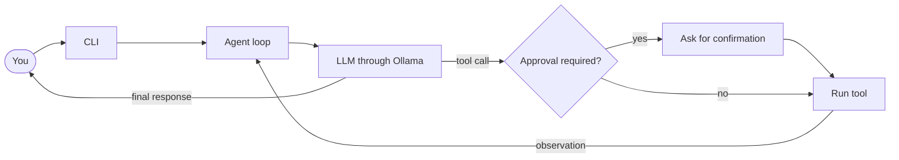

<div align="center">


# S P R O U T

**A small, tool-using agent development harness**

*Where agents begin to grow.*

<br>


<br>

[Features](#features) · [Quick Start](#quick-start) · [Configuration](#configuration) · [CLI](#using-the-cli) · [Tools](#built-in-tools) · [Architecture](#how-it-works) · [Safety](#safety-notes)

</div>

<br>

SPROUT is an experimental terminal agent for exploring how language models, tool calling, memory, and planning fit together. It connects to Ollama's OpenAI-compatible API and can work with files in a configured workspace.

> [!NOTE]
> The Python package and import name is `SPROUT`; the terminal application is branded **SPROUT**.

---

## Features

| | |
| --- | --- |
| 💬 **Interactive terminal chat** | Work with an Ollama model from a command-line interface |
| 🔧 **Native tool calling** | Let the model request registered functions through an OpenAI-compatible chat completions API |
| 📂 **Workspace tools** | Read, search, inspect, and manage workspace files |
| 🧪 **Development tools** | Run pytest and lint Python code with Ruff |
| 🌿 **Git tools** | Inspect repository status, diffs, history, and line attribution |
| 🧠 **Agent building blocks** | Experiment with ReAct planning, memory strategies, and model clients |
| 🪴 **Skills** | Load `SKILL.md` instructions as callable tools |
| 🎨 **Terminal display** | Rich formatting when installed, with a plain display fallback |

## Quick Start

### Requirements

- Python **3.10** or newer
- [Ollama](https://ollama.com/download)
- An Ollama model that supports tool calling

### Install

Run these commands from the repository root.

<details open>
<summary><b>🪟 Windows (PowerShell)</b></summary>

```powershell
py -3.10 -m venv .venv
.\.venv\Scripts\Activate.ps1
python -m pip install -r requirements.txt
```

</details>

<details>
<summary><b>🍎 macOS / 🐧 Linux</b></summary>

```bash
python3 -m venv .venv
source .venv/bin/activate
python -m pip install -r requirements.txt
```

</details>

Rich formatting is optional. Install it separately with `python -m pip install rich`; SPROUT uses a plain terminal display when Rich is unavailable.

### Run with Ollama

Make sure Ollama is running, pull the default model, and launch SPROUT from the repository root:

```bash
ollama pull gemma4:e4b
python -m SPROUT.cli
```

Choose another installed model with `--model`:

```bash
python -m SPROUT.cli --model gemma3:4b
```

### Use an Ollama cloud model

Sign in to Ollama and verify that the cloud model is available:

```bash
ollama signin
ollama run gemma4:31b-cloud
```

Then, from the repository root, launch SPROUT:

```bash
python -m SPROUT.cli --model gemma4:31b-cloud
```

> [!IMPORTANT]
> Cloud inference requires an Ollama account and sends model requests to Ollama's cloud service.

## Configuration

| Option | Default | Purpose |
| --- | --- | --- |
| `--model` | `gemma4:e4b` | Model name sent to the API |
| `--api_base` | `http://localhost:11434/v1` | OpenAI-compatible API base URL |
| `--api_key` | `no_key` | API key sent as a bearer token |

Example:

```bash
python -m SPROUT.cli \
  --model gemma4:31b-cloud \
  --api_base http://localhost:11434/v1
```

The configured endpoint must support chat completions and native tool calling.

> [!WARNING]
> Avoid passing sensitive API keys directly in shell commands, where they may be saved in terminal history.

## Using the CLI

Enter a prompt at the input line to start a task.

| Command | Action |
| --- | --- |
| `/help` | Show available commands |
| `/clear` | Clear conversation history while keeping the system prompt |
| `/memory` | Display conversation messages |
| `/model` | Display the selected model |
| `/tools` | List registered tools |
| `/skills` | List loaded skills |
| `exit` or `quit` | Exit SPROUT |

You can also press `Ctrl+C` to exit.

## Built-in Tools

The default CLI registers tools in these categories:

| Category | Tools |
| --- | --- |
| **Read and explore** | `read_file`, `read_lines`, `list_files`, `tree`, `find_files`, `search_file`, `search_code`, `python_outline`, `read_json`, `read_csv` |
| **Write and manage files** | `write_file`, `edit_file`, `append_file`, `make_dir`, `delete_file`, `move_file` |
| **Run checks** | `run_tests`, `run_linter`, `execute_python` |
| **Git** | `git_status`, `git_diff`, `git_log`, `git_show`, `git_blame`, `git_add`, `git_commit` |

File tools are scoped to the workspace passed to `create_native_code_tools()`. The default CLI uses the current working directory.

### Tool approvals

SPROUT asks for confirmation before these tools run:

- File changes: `write_file`, `edit_file`, `append_file`, `delete_file`, `move_file`
- Code and tests: `execute_python`, `run_tests`
- Git changes: `git_add`, `git_commit`

`make_dir` currently creates directories without an approval prompt. Read-only tools such as `git_status`, `git_diff`, and `search_code` do not require approval.

### Testing and linting

`run_tests` invokes pytest. The repository currently has no automated tests, so pytest may report that no tests were collected until tests are added.

`run_linter` uses Ruff when installed. If Ruff is unavailable, it falls back to Python syntax checks using the standard library. Ruff and pytest are listed in `requirements.txt`.

Ask SPROUT to run the test suite or lint a file or directory. Tools that execute commands ask for approval first.

## Skills

At startup, the CLI loads `SKILL.md` files from subdirectories under `SPROUT/skills/`. Use `/skills` to list the loaded skills. The model can activate a skill as a tool to receive its instructions.

The included `file-analyzer` skill analyzes local files using the `read_file` tool. URL fetching is not currently supported.

## How It Works



The agent sends the conversation and available tool schemas to the model. If the model requests a tool, SPROUT runs it, adds the result to the conversation, and asks the model for the next step. The loop ends when the model returns a final response or the configured step limit is reached.

## Project Structure

| Path | Responsibility |
| --- | --- |
| `SPROUT/cli.py` | CLI arguments, interactive loop, slash commands, and skill loading |
| `SPROUT/agent.py` | Agent orchestration loop |
| `SPROUT/llm.py` | LLM and embedding clients, response types, and trajectory records |
| `SPROUT/planning.py` | ReAct, native ReAct, Plan-and-Solve, and reflection components |
| `SPROUT/tools.py` | Tool schemas, registration, execution, and skill loading |
| `SPROUT/toolbox.py` | Workspace file, code, lint, test, and Git tools |
| `SPROUT/memory.py` | Conversation, trimming, summarization, multimodal, and retrieval memory |
| `SPROUT/display.py` | SPROUT branding and terminal display handlers |
| `SPROUT/mcp.py` | Experimental MCP client code |
| `SPROUT/skills/` | Skill instruction files |
| `SPROUT/assests/sprout.svg` | SPROUT logo used in this README |

## Safety Notes

> [!CAUTION]
> SPROUT can modify files, execute Python, run tests, stage changes, and create Git commits after user confirmation. Review each request before approving it. The approval prompt is a safeguard, not a sandbox.

`execute_python` runs arbitrary Python code and is **not sandboxed** by the workspace path checks; code may access other files or resources available to your user account. Only run SPROUT in a workspace and environment you trust.

## Development Status

SPROUT is an educational and experimental project, not a hardened autonomous coding product.

- The default CLI loads built-in tools and skill files.
- The repository does not currently include an automated test suite.
- MCP support is experimental and is not connected to the default CLI flow.
- `make_dir` currently does not require approval.

## License

SPROUT is distributed under the [GNU General Public License v3.0](LICENSE).

<div align="center">

<br>

*Where agents begin to grow.* 🌱

</div>