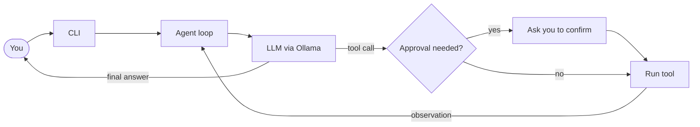

<div align="center">


# S P R O U T

**A small, tool-using agent development harness**

*Where agents begin to grow.*

<br>


<br>

[Features](#-features) · [Quick Start](#-quick-start) · [Configuration](#%EF%B8%8F-configuration) · [CLI](#-using-the-cli) · [Tools](#-built-in-tools) · [Structure](#-project-structure) · [Safety](#-safety-notes)

</div>

<br>

SPROUT is an experimental terminal agent built to explore how language models, tool calling, memory, and planning fit together. It connects to Ollama's OpenAI-compatible API and includes tools for inspecting and working with files in the directory where it is launched.

> [!NOTE]
> The Python package/import name is `Tinyagent`. The terminal interface is branded **SPROUT**.

---

## ✨ Features

| | |
| --- | --- |
| 💬 **Interactive chat** | Terminal chat with an Ollama model |
| 🔧 **Native tool calling** | Function calls through an OpenAI-compatible chat completions API |
| 📂 **Workspace tools** | Read, search, list, and write files in your working directory |
| 🐍 **Python execution** | Run Python code, gated behind an approval prompt |
| 🧠 **Memory & planning** | Conversation memory and configurable ReAct planners |
| 🎨 **Rich output** | Styled terminal display with `rich`, plain fallback without it |

---

## 🚀 Quick Start

### Requirements

- Python **3.10** or newer
- [Ollama](https://ollama.com/download)
- An Ollama model that supports tool calling

### Install

From the repository root:

<details open>
<summary><b>🪟 Windows (PowerShell)</b></summary>

```powershell
py -3.10 -m venv .venv
.\.venv\Scripts\Activate.ps1
python -m pip install -r requirements.txt
```

</details>

<details>
<summary><b>🍎 macOS / 🐧 Linux</b></summary>

```bash
python3 -m venv .venv
source .venv/bin/activate
python -m pip install -r requirements.txt
```

</details>

> [!TIP]
> Rich formatting is optional. Install it with `python -m pip install rich`; otherwise, SPROUT uses its plain terminal display.

### Run with Ollama

Make sure Ollama is running, then download the default model and launch SPROUT from the repository root:

```bash
ollama pull gemma4:e4b
python -m Tinyagent.cli
```

To choose another installed model:

```bash
python -m Tinyagent.cli --model gemma3:4b
```

### ☁️ Use a cloud-hosted model

To use Ollama's cloud-hosted Gemma model, sign in and select the cloud model:

```bash
ollama signin
ollama run gemma4:31b-cloud
```

Then, in the repository root, launch SPROUT:

```bash
python -m Tinyagent.cli --model gemma4:31b-cloud
```

> [!IMPORTANT]
> Cloud inference requires an Ollama account and sends model requests to Ollama's cloud service.

---

## ⚙️ Configuration

| Option | Default | Purpose |
| --- | --- | --- |
| `--model` | `gemma4:e4b` | Model name passed to the API |
| `--api_base` | `http://localhost:11434/v1` | OpenAI-compatible API base URL |
| `--api_key` | `no_key` | API key sent as a bearer token |

For example, to set the model and API base explicitly:

```bash
python -m Tinyagent.cli \
  --model gemma4:31b-cloud \
  --api_base http://localhost:11434/v1
```

The selected endpoint must support chat completions and tool calling.

> [!WARNING]
> Avoid putting sensitive API keys directly in shell commands, where they may be retained in terminal history.

---

## 💻 Using the CLI

Enter a prompt at the terminal input. Available commands:

| Command | Action |
| --- | --- |
| `/help` | Show available commands |
| `/clear` | Clear conversation history while keeping the system prompt |
| `/memory` | Display conversation messages |
| `/model` | Display the selected model |
| `/tools` | List registered tools |
| `exit` or `quit` | Exit SPROUT |

Press `Ctrl+C` to exit as well.

---

## 🧰 Built-in Tools

The default CLI registers these tools:

| Tool | Category | Needs approval |
| --- | --- | :---: |
| `read_file`, `read_lines` | 📖 Read | |
| `list_files`, `find_files`, `search_file` | 🔍 Explore | |
| `write_file` | ✏️ Write | ✅ |
| `execute_python` | 🐍 Execute | ✅ |

File paths are resolved relative to the directory from which SPROUT is launched. SPROUT asks for confirmation before `write_file` and `execute_python` run.

---

## 🔄 How It Works



Each turn, SPROUT shows what the model is thinking, which tool it wants to call, and what the tool returned, until it reaches an answer.

---

## 🗂️ Project Structure

| File | Responsibility |
| --- | --- |
| `Tinyagent/cli.py` | CLI arguments, interactive loop, and slash commands |
| `Tinyagent/agent.py` | Agent orchestration loop |
| `Tinyagent/llm.py` | LLM and embedding API clients, response and trajectory types |
| `Tinyagent/planning.py` | ReAct planners, Plan-and-Solve, and reflection components |
| `Tinyagent/tools.py` | Tool schemas, registration, execution, and skill-loading support |
| `Tinyagent/toolbox.py` | Workspace-scoped file and Python tools |
| `Tinyagent/memory.py` | Conversation, trimming, summarization, multimodal, and retrieval memory |
| `Tinyagent/display.py` | SPROUT terminal branding and display handlers |
| `Tinyagent/mcp.py` | Experimental MCP client code |
| `Tinyagent/skills/` | Skill instruction files |

---

## 🛡️ Safety Notes

> [!CAUTION]
> SPROUT can write files and execute Python code after user confirmation. Only run it in a workspace you trust, review tool requests before approving them, and don't expose the agent to untrusted prompts with approval enabled. **The approval prompt is a safeguard, not a sandbox.**

---

## 🌱 Development Status

SPROUT is an educational and experimental project, not a hardened autonomous coding product.

- The default CLI currently loads its built-in tools. Skill files and MCP support are not automatically connected to that CLI flow.
- The repository does not currently include an automated test suite.

---

## 📄 License

SPROUT is distributed under the [GNU General Public License v3.0](LICENSE).

<div align="center">

<br>

*Where agents begin to grow.* 🌱

</div>