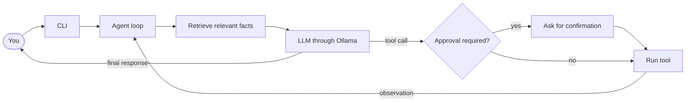

<div align="center">


# S P R O U T

**A lightweight, modular harness for building and running terminal-based AI agents**

*Where agents begin to grow.*

<br>


<br>

[Features](#features) · [Quick Start](#quick-start) · [Configuration](#configuration) · [CLI](#using-the-cli) · [Tools](#built-in-tools) · [Memory](#memory) · [Architecture](#how-it-works) · [Safety](#safety-notes)

</div>

<br>

Its runnable CLI demonstrates native tool calling, conversation summarization, SQLite-backed fact memory, and workspace tools, using Ollama’s OpenAI-compatible API. It can also work with files and Git repositories.

> [!NOTE]
> The Python package and import name is `SPROUT`; the terminal application is branded **SPROUT**.

---

## Features

| | |
| --- | --- |
| 💬 **Interactive terminal chat** | Work with an Ollama model from a command-line interface |
| 🔧 **Native tool calling** | Let the model request registered functions through an OpenAI-compatible chat completions API |
| 📂 **Workspace tools** | Read, search, inspect, and manage workspace files |
| 🧪 **Development tools** | Run pytest and lint Python code with Ruff |
| 🌿 **Git tools** | Inspect repository status, diffs, history, and line attribution |
| 🧠 **Conversation memory** | Preserve recent context and summarize older turns |
| 💾 **Persistent fact memory** | Store, retrieve, and forget approved facts using SQLite |
| 🪴 **Skills** | Load `SKILL.md` instructions as callable tools |
| 🎨 **Terminal display** | Rich formatting when installed, with a plain display fallback |

## Quick Start

### Requirements

- Python **3.10** or newer
- [Ollama](https://ollama.com/download)
- An Ollama model that supports tool calling

### Install

Run these commands from the repository root.

<details open>
<summary><b>🪟 Windows (PowerShell)</b></summary>

```powershell
py -3.10 -m venv .venv
.\.venv\Scripts\Activate.ps1
python -m pip install -r requirements.txt
```

</details>

<details>
<summary><b>🍎 macOS / 🐧 Linux</b></summary>

```bash
python3 -m venv .venv
source .venv/bin/activate
python -m pip install -r requirements.txt
```

</details>

Rich formatting is optional. Install it separately with `python -m pip install rich`; SPROUT uses a plain terminal display when Rich is unavailable.

### Run with Ollama

Pull the default chat model and the embedding model used for persistent memory, then launch SPROUT from the repository root:

```bash
ollama pull gemma4:e4b
ollama pull embeddinggemma
python -m SPROUT.cli
```

Choose another installed chat model with `--model`:

```bash
python -m SPROUT.cli --model gemma3:4b
```

### Use an Ollama cloud chat model

Sign in to Ollama and verify that the cloud model is available:

```bash
ollama signin
ollama run gemma4:31b-cloud
```

Then, from the repository root, launch SPROUT:

```bash
python -m SPROUT.cli --model gemma4:31b-cloud
```

> [!IMPORTANT]
> Cloud chat inference requires an Ollama account and sends chat requests to Ollama’s cloud service. Persistent memory still uses the configured Ollama API endpoint for embeddings.

## Configuration

| Option | Default | Purpose |
| --- | --- | --- |
| `--model` | `gemma4:e4b` | Chat model name sent to the API |
| `--api_base` | `http://localhost:11434/v1` | OpenAI-compatible API base URL |
| `--api_key` | `no_key` | API key sent as a bearer token |

Example:

```bash
python -m SPROUT.cli \
  --model gemma4:31b-cloud \
  --api_base http://localhost:11434/v1
```

The configured API must support chat completions and native tool calling. Persistent memory also uses the configured endpoint’s embeddings API with the `embeddinggemma` model.

> [!WARNING]
> Avoid passing sensitive API keys directly in shell commands, where they may be saved in terminal history.

## Using the CLI

Enter a prompt at the input line to start a task.

| Command | Action |
| --- | --- |
| `/help` | Show available commands |
| `/clear` | Clear conversation history and summary while keeping the system prompt |
| `/memory` | Display current conversation messages |
| `/model` | Display the selected chat model |
| `/tools` | List registered tools |
| `/skills` | List loaded skills |
| `exit` or `quit` | Exit SPROUT |
| `/memories` | List saved facts and their IDs |

You can also press `Ctrl+C` to exit.

## Built-in Tools

The default CLI registers tools in these categories:

| Category | Tools |
| --- | --- |
| **Read and explore** | `read_file`, `read_lines`, `list_files`, `tree`, `find_files`, `search_file`, `search_code`, `python_outline`, `read_json`, `read_csv` |
| **Write and manage files** | `write_file`, `edit_file`, `append_file`, `make_dir`, `delete_file`, `move_file` |
| **Run checks** | `run_tests`, `run_linter`, `execute_python` |
| **Git** | `git_status`, `git_diff`, `git_log`, `git_show`, `git_blame`, `git_add`, `git_commit` |
| **Persistent memory** | `remember_fact`, `forget_fact`, `forget_fact_by_id` |

File tools are scoped to the workspace passed to `create_native_code_tools()`. The CLI uses the current working directory.

### Tool approvals

SPROUT asks for confirmation before these tools run:

- File changes: `write_file`, `edit_file`, `append_file`, `delete_file`, `move_file`, `make_dir`
- Code and tests: `execute_python`, `run_tests`
- Git changes: `git_add`, `git_commit`
- Persistent memory changes: `remember_fact`, `forget_fact`, `forget_fact_by_id`

Read-only tools such as `git_status`, `git_diff`, and `search_code` do not require approval.

### Testing and linting

Run the test suite from the repository root:

```bash
python -m pytest -q
```

`run_linter` uses Ruff when installed. If Ruff is unavailable, it falls back to Python syntax checks using the standard library. Ruff and pytest are listed in `requirements.txt`.

## Memory

SPROUT uses two separate forms of memory:

- **Conversation memory** is held in process memory. `SummarizationMemory` keeps system instructions and recent turns while summarizing older turns. It is cleared when SPROUT exits.
- **Persistent fact memory** stores explicitly approved facts and their embeddings in `sprout_memory.sqlite3` at the repository root. When a task begins, SPROUT retrieves up to three facts with cosine similarity of at least `0.5`.

Use `/memories` to inspect saved facts and their IDs. To remove one, ask SPROUT to forget the listed ID and approve the `forget_fact_by_id` tool call. You can also remove a fact by asking SPROUT to forget its exact saved text and approving `forget_fact`. `/clear` clears only conversation memory; it does not erase facts in SQLite.

To erase all persistent facts, exit SPROUT and delete `sprout_memory.sqlite3`. The database is gitignored, but it is not encrypted.


## Skills

At startup, the CLI loads `SKILL.md` files from subdirectories under `SPROUT/skills/`. Use `/skills` to list loaded skills. The model can activate a skill as a tool to receive its instructions.

The included `file-analyzer` skill analyzes local files using the `read_file` tool. URL fetching is not currently supported.

## How It Works



For each task, the agent searches persistent memory and adds retrieved material to the model request without saving it as conversation history. The agent then follows the model’s native tool calls, adds tool results to conversation memory, and continues until it reaches a final answer or the step limit.

## Project Structure

| Path | Responsibility |
| --- | --- |
| `SPROUT/cli.py` | CLI arguments, interactive loop, slash commands, and skill loading |
| `SPROUT/core/agent.py` | Agent orchestration and optional retrieval context |
| `SPROUT/core/llm.py` | LLM and embedding clients and response types |
| `SPROUT/core/planning.py` | ReAct, native ReAct, Plan-and-Solve, and reflection components |
| `SPROUT/core/trajectory.py` | Agent run and step records |
| `SPROUT/memory/conversation.py` | Conversation, trimming, summarization, and multimodal memory |
| `SPROUT/memory/retrieval.py` | SQLite-backed document retrieval |
| `SPROUT/tools/registry.py` | Tool schemas, registration, execution, and skill loading |
| `SPROUT/tools/workspace.py` | Workspace, development, Git, and memory tools |
| `SPROUT/integrations/mcp.py` | Experimental MCP client code |
| `SPROUT/ui/display.py` | SPROUT terminal display |
| `SPROUT/dev/notebook_views.py` | Notebook-oriented code and trajectory viewers |
| `SPROUT/dev/legacy_display.py` | Retained legacy terminal display implementation |
| `SPROUT/skills/` | Skill instruction files |
| `SPROUT/assets/sprout.svg` | SPROUT logo used in this README |
| `tests/` | Unit and integration tests |

## Safety Notes

> [!CAUTION]
> SPROUT can modify files, execute Python, run tests, stage changes, commit changes, and alter persistent memory after user confirmation. Review every request before approving it. The approval prompt is a safeguard, not a sandbox.

`execute_python` runs arbitrary Python code and is **not sandboxed** by the workspace path checks; code may access other files or resources available to your user account. Only run SPROUT in a workspace and environment you trust.

## Development Status

SPROUT is an educational and experimental project, not a hardened autonomous coding product.

- The default CLI loads built-in tools and skill files.
- Persistent memory stores explicitly saved facts in local SQLite; it does not automatically index workspace files.
- Retrieval returns up to three facts with cosine similarity of at least 0.5.
- MCP support is experimental and is not connected to the default CLI flow.
- The repository includes pytest coverage for memory summarization, retrieval, agent context, and approval-gated memory tools.

## Acknowledgements

SPROUT began as a learning project based on *An Illustrated Guide to AI Agents* by Maarten Grootendorst and Jay Alammar, published by O’Reilly. It has since been reorganized and extended into this modular project.

## License

SPROUT is distributed under the [GNU General Public License v3.0](LICENSE).

<div align="center">

<br>

*Where agents begin to grow.* 🌱

</div>